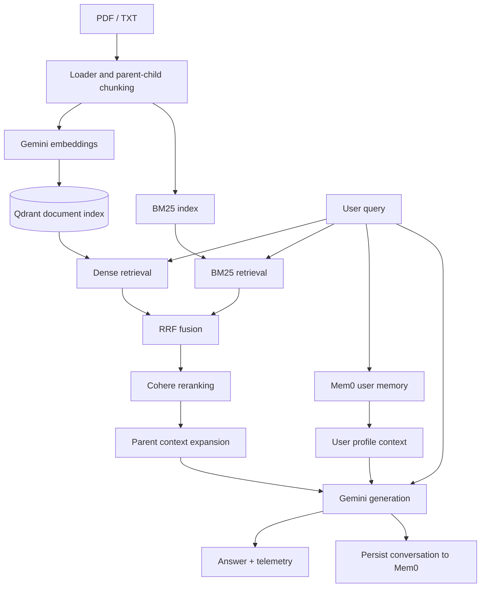

# Advanced RAG Agent with Context Compression & Semantic Memory

A Python RAG assistant combining hybrid document retrieval, parent-child context expansion, Cohere reranking, persistent semantic memory, and a FastAPI chat API.

**Stack:** Python 3.11+, FastAPI, Gemini embeddings and generation, Qdrant, BM25, Reciprocal Rank Fusion (RRF), Cohere ReRank, LangChain contextual compression, Mem0 OSS, and Pytest.

## Features

- PDF/TXT ingestion and parent-child chunking (parent target: 1,000 characters; child target: 200 characters).
- Dense Gemini embedding retrieval plus sparse BM25 retrieval, merged with RRF.
- Parent context expansion after matching child chunks.
- Cohere reranking of up to 20 candidates, retaining the top 5 by default.
- Mem0 OSS long-term semantic memory, scoped by `user_id`.
- Cross-session personalization through the user profile injected into the generation prompt.
- FastAPI chat and memory endpoints.
- Retrieval, rerank, generation, and total latency telemetry.
- Unit and API tests with mocked external dependencies.

## Architecture



## Project structure

```text
app/
  api/          FastAPI routes
  core/         settings
  ingestion/    PDF/TXT loading, chunking, parent store
  memory/       Mem0 adapter and demo
  retrieval/    Gemini embeddings, Qdrant, BM25, RRF, reranking
  schemas/      request models
  services/     RAG orchestration and telemetry
data/documents/ source PDF and TXT files
scripts/        indexing helper
tests/          unit and API tests
docs/           architecture notes
postman/        Postman collection
```

## Setup (Windows PowerShell)

Run commands from the repository root.

### 1. Create and activate the virtual environment

```powershell
py -3.11 -m venv .venv
.\.venv\Scripts\Activate.ps1
```

If activation is blocked in the current terminal:

```powershell
Set-ExecutionPolicy -Scope Process -ExecutionPolicy Bypass
.\.venv\Scripts\Activate.ps1
```

### 2. Install dependencies

```powershell
python -m pip install --upgrade pip
python -m pip install -r requirements.txt
```

### 3. Configure API keys

```powershell
Copy-Item .env.example .env
```

Open `.env` and set:

```dotenv
GEMINI_API_KEY=your_gemini_api_key
COHERE_API_KEY=your_cohere_api_key
```

Mem0 is configured in OSS/local mode; a Mem0 Platform key is not required. Keep `.env` private; it is ignored by Git.

Important settings:

| Variable | Purpose | Default |
|---|---|---|
| `GEMINI_API_KEY` | Gemini embeddings, generation, and Mem0 LLM | Required |
| `GEMINI_CHAT_MODEL` | Gemini answer model | `gemini-3.5-flash-lite` |
| `COHERE_API_KEY` | Cohere reranking | Required when reranking candidates |
| `RERANK_MODEL` | Cohere rerank model | `rerank-english-v3.0` |
| `RERANK_TOP_N` | Number of reranked results retained | `5` |
| `RERANK_MIN_SCORE` | Minimum relevance score | `0.0` |
| `QDRANT_URL` | Optional remote Qdrant URL for document index | Empty = local |
| `QDRANT_API_KEY` | Optional remote Qdrant key | Empty |
| `QDRANT_LOCAL_PATH` | Local document-index path | `data/qdrant` |
| `QDRANT_COLLECTION` | Document collection | `child_chunks` |
| `MEM0_LLM_MODEL` | Mem0 Gemini model | `gemini-3.5-flash-lite` |
| `MEM0_EMBEDDING_MODEL` | Mem0 embedding model | `models/gemini-embedding-001` |
| `MEM0_EMBEDDING_DIMS` | Mem0 vector dimensions | `768` |
| `MEM0_QDRANT_PATH` | Separate local memory index | `data/mem0_qdrant` |
| `MEM0_COLLECTION` | Memory collection | `personal_memories` |
| `MEM0_HISTORY_DB_PATH` | Mem0 history database | `data/mem0_history.db` |

The document index and user-memory index are separate.

### 4. Add documents

Place `.pdf` and `.txt` files in `data/documents/`.

### 5. Ingest and chunk documents

```powershell
python -m app.ingestion.ingest
```

This creates or updates `data/parent_documents.json` and `data/child_chunks.json`.

### 6. Build the Qdrant dense index

```powershell
python -m scripts.index_documents
```

This helper reads the child chunks, generates Gemini embeddings, and upserts them into the configured Qdrant collection. Run it again after adding or changing source documents.

### 7. Start the API

```powershell
uvicorn app.main:app --reload
```

- Swagger UI: http://127.0.0.1:8000/docs
- Health check: http://127.0.0.1:8000/health

## API

### `GET /health`

Example response:

```json
{"status": "ok", "project": "advanced-rag-memory-agent"}
```

### `POST /api/chat`

Request:

```json
{
  "query": "Explain how Python decorators work.",
  "user_id": "usr_99",
  "session_id": "session_1"
}
```

Response shape:

```json
{
  "answer": "A decorator is ...",
  "user_id": "usr_99",
  "session_id": "session_1",
  "sources": ["data/documents/sample.txt"],
  "telemetry": {
    "retrieval_latency_ms": 12.3,
    "rerank_latency_ms": 34.5,
    "generation_latency_ms": 456.7,
    "total_latency_ms": 520.1
  }
}
```

Latency and source values above are illustrative; actual values depend on the query, documents, network, and API response.

### `GET /api/users/{user_id}/memories`

Example:

```http
GET http://127.0.0.1:8000/api/users/usr_99/memories
```

Returns the memories stored for that user.

## Cross-session memory verification

1. Send this request to `POST /api/chat`:

```json
{
  "query": "Hello! I work in Python and prefer brief, code-only responses.",
  "user_id": "usr_99",
  "session_id": "session_1"
}
```

2. Call `GET /api/users/usr_99/memories`. Mem0 should return the Python and concise/code-only preferences (the extracted wording may differ slightly).

3. Send a second chat request using the same `user_id` and a new session:

```json
{
  "query": "Write a quick merge sort routine.",
  "user_id": "usr_99",
  "session_id": "session_2"
}
```

The answer should reflect the saved preferences, using concise Python code.

## Tests

```powershell
python -m pytest -v
```

The M7 verification run completed with **42 passing tests**. Run the command on the final checkout to verify it again. Tests cover ingestion/retrieval logic, RRF, reranking, memory behavior, API contracts, orchestration, memory isolation, validation, and controlled dependency failures. Unit tests mock external Gemini/Cohere calls; live integration requires valid keys and network access.

## Postman

Import `postman/Advanced-RAG-Memory-Agent.postman_collection.json`. Set `base_url`, `user_id`, and `session_id` collection variables. The collection includes health, chat, memory lookup, and a second-session chat request.

## Git and secret hygiene

Before committing:

```powershell
git status --short
git diff --check
```

Do not commit `.env`, `.venv/`, `data/qdrant/`, `data/mem0_qdrant/`, `data/mem0_history.db`, or generated parent/child JSON stores. These are local configuration/runtime files and are excluded by `.gitignore`.

## Limitations and future improvements

- This is a backend API; no frontend is included.
- Gemini and Cohere require valid credentials, network access, and available quota.
- Local Qdrant and Mem0 data live on the machine running the service.
- Production deployment should add authentication, rate limiting, structured logging, request tracing, and managed persistent storage.

## Milestones

1. M1 — Project setup and API skeleton
2. M2 — Document ingestion and parent-child chunking
3. M3 — Gemini embeddings, Qdrant, hybrid retrieval, and RRF
4. M4 — Cohere reranking and contextual compression
5. M5 — Mem0 semantic memory
6. M6 — FastAPI orchestration, Gemini generation, and telemetry
7. M7 — Reliability, validation, and memory-isolation tests
8. M8 — Documentation and submission readiness
